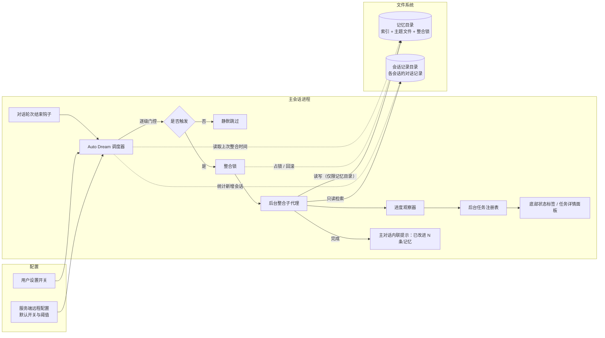
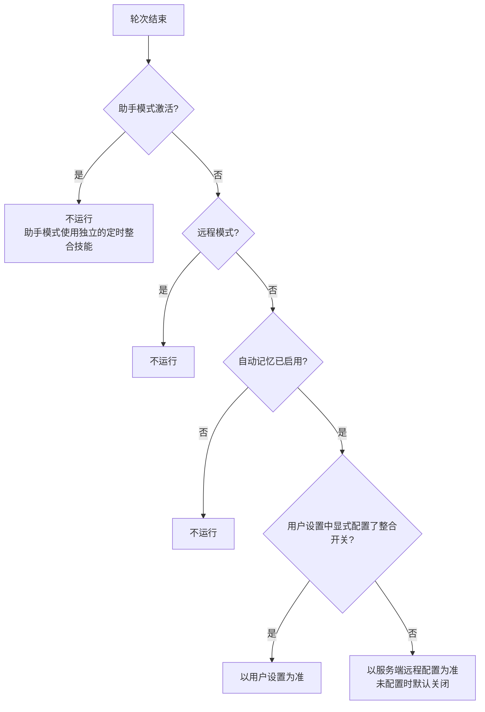
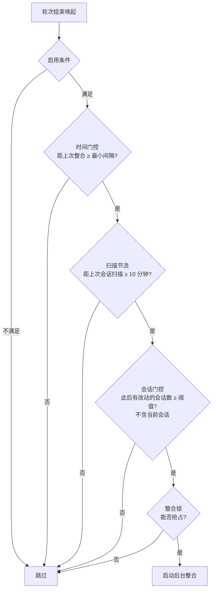
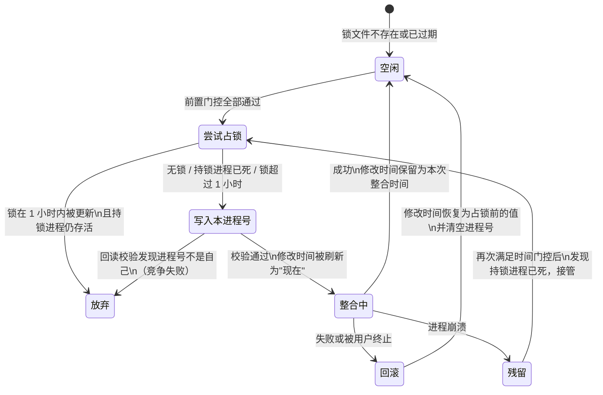
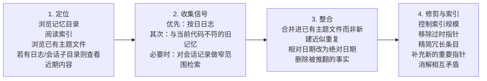
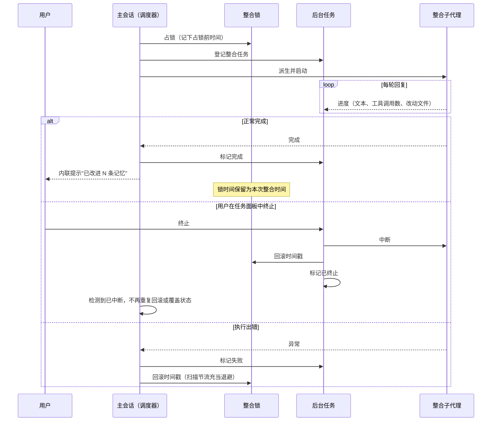

# 长期记忆：Auto Dream 后台定期离线记忆整合

> 说明：本章依据本仓库源码整理，只描述代码中能看到的设计。由命名、注释或调用关系推断、代码中没有直接实现的内容，会标注"推测"。

## 1. 定位与目标

Claude Code 的长期记忆以文件形式存在，每个项目一个记忆目录，内容分两层：

- **一个索引入口**：每条记忆占一行，只放指针和一句话摘要。
- **若干主题记忆文件**：按主题存放具体内容。

记忆的写入分两条链路，二者互补：

| 链路 | 时机 | 粒度 | 职责 |
| --- | --- | --- | --- |
| 在线增量抽取 | 每轮对话结束 | 单轮、单会话 | 把本轮新出现的值得记住的信息及时写入记忆 |
| **离线定期整合（Auto Dream）** | 满足时间与会话数阈值后 | 跨多个会话、作用于整个记忆库 | 对已积累的记忆做一次"反思"：合并重复、纠正过时、清理冗余、重建索引 |

在线抽取保证"记得住"，但随会话增多，记忆库会出现重复条目、相互矛盾的事实、失效的相对时间（如"昨天"）、索引膨胀等问题。Auto Dream 的目标是**在后台、低成本、不打扰用户的前提下，定期把零散积累的记忆提炼成结构良好、可长期使用的知识**，让后续会话能更快建立上下文。

"Dream"取自人在睡眠中整理白天记忆的过程：它不参与当前任务，只在合适的时机回顾和整理过去。

## 2. 总体架构

模块由五部分组成：

1. **调度器**：随主对话每轮结束被唤起，按"开销从低到高"逐级判断是否需要整合。
2. **配置层**：一个依赖极少的叶子模块，负责回答"是否启用"。界面组件可以直接读取它，不必加载整条执行链路。
3. **整合锁**：基于文件系统的跨进程互斥机制，同时记录"上次整合时间"。
4. **整合执行体**：一个从主会话派生的后台子代理，按四阶段指令整理记忆，运行在严格的权限沙箱中。
5. **可视化与控制**：把原本不可见的后台子代理接入通用后台任务框架，用户能看到进度，也能随时终止。

## 3. 触发机制：搭载于对话轮次，而非独立定时器

Auto Dream **没有独立的守护进程或定时器**，它搭载在主对话的"轮次结束"生命周期上：

- **初始化**：程序启动时，在后台内务初始化阶段与在线记忆抽取一起完成初始化，建立调度器的内部状态。调度器状态封装在初始化产生的闭包中，而不是放在全局变量里，便于测试时每次拿到全新实例。
- **唤起**：每轮对话结束时，轮次结束钩子以"发出即不管"的方式异步调用调度器，不阻塞主对话的返回。
- **唤起范围**：
  - 只在主线程触发，子代理的轮次结束不会触发，避免嵌套和重复。
  - 精简（脚本化、非交互）模式下，整组后台记账任务都跳过，包括提示建议、记忆抽取和整合，避免进程退出时还有派生代理在争抢资源。

**取舍**：搭载于对话轮次，模块不需要自己管理生命周期，也不会在用户不使用产品时偷偷消耗资源。代价是整合只会发生在用户仍在使用产品的时候；长时间不打开产品，整合会推迟到下次使用时。（推测：这是有意为之，因为没有新会话就没有新信息需要整合。）

## 4. 启用条件与配置

是否启用由多层条件共同决定，任一条件不满足即直接返回：

- **与助手模式互斥**：助手模式下，会话近似常驻，记忆以"按日追加日志"的方式写入，由一个独立的、按计划定时（夜间）执行的整合技能来提炼。两种模式各用自己的整合路径，互不干扰。（该定时整合技能的实现不在本仓库中，这里只依据引用和注释描述。）
- **依赖自动记忆总开关**：自动记忆关闭时，整合没有意义。远程环境如果没有专门配置记忆目录，也会关闭自动记忆。
- **开关优先级**：用户设置优先于服务端默认值。也就是说，服务端可以灰度控制默认是否开启，而用户的显式选择始终生效。
- **调度阈值**来自服务端远程配置：
  - 最小间隔时长，默认 24 小时。
  - 最少新增会话数，默认 5 个。
  - 远程配置读自本地缓存，可能过期，也可能类型不对，因此每个字段都单独校验，必须是有限的正数，否则回退到默认值。
- **入口**：
  - 用户可以在记忆管理面板中直接切换开关，切换结果写入用户级设置，并上报埋点。
  - 该开关也注册在配置工具支持的设置项中，模型可以按用户要求修改它。

## 5. 调度策略：开销由低到高的逐级门控

整合是一次完整的模型推理任务，成本不低，而调度器每轮都会被调用。因此调度器采用**开销从低到高**的门控顺序，绝大多数轮次在第一、二步就以近乎零成本结束。启用时，常态下每轮的开销只有一次配置缓存读取加一次文件元信息查询。

各级门控的设计要点：

1. **时间门控**：只查询一次锁文件的修改时间（见第 6 节），与当前时间比较。锁文件不存在时视为"从未整合"，时间门控直接通过。
2. **扫描节流**：存在一个边界情况：时间门控已通过，但新会话数不够。这时"上次整合时间"不会前进，时间门控在之后每一轮都会通过，进而每轮都去扫描会话目录。为此引入进程内的扫描节流：两次会话扫描至少间隔 10 分钟。
3. **会话门控**：
   - 统计当前项目的会话记录目录中，修改时间晚于上次整合时间的会话数。
   - 用"修改时间"，衡量的是"被使用过"的会话，而不是"新建"的会话，也避开了部分文件系统不提供可靠创建时间的问题。
   - 子代理产生的记录文件会被排除，只统计正式会话。
   - 当前会话也会被排除，因为它的修改时间总是最新的，计入会让门槛虚低。
   - 这一级只是"是否跳过"的判断，所以对不在当前目录下的工作树会话少计数是可以接受的，结果只会偏保守。
4. **整合锁**：最后一级，保证同一时刻只有一个进程在整合同一个记忆库。

任何一级在读取文件系统时出错，都只记调试日志并静默跳过，不影响主对话。

## 6. 并发控制：一个文件，两种语义

多个终端、多个会话可能同时打开同一个项目，它们共享同一个记忆库。整合锁用一个极简的设计解决两个问题：

- **锁文件的修改时间 = 上次整合时间**。时间门控只需查询它，不需要额外的状态文件。
- **锁文件的内容 = 当前持锁进程的进程号**，用来判断持锁者是否还活着。

锁文件放在记忆目录内部，带来两个好处：

- 它和记忆一样以项目（代码仓库根目录）为单位。
- 即使记忆目录被环境变量或设置重定向到别处，也能保证有写权限。

关键设计：

- **乐观盖章**：一占到锁，"上次整合时间"就刷新为当前时间，而不是等整合完成再记录。成功时无需额外动作，失败时再回滚。
- **可回滚**：占锁时记下占锁前的时间戳。整合失败或被用户终止后：
  - 把时间戳恢复回去，使时间门控能再次通过；
  - 清空进程号，避免仍在运行的本进程被误判为持锁者；
  - 如果占锁前根本没有锁文件，则直接删除，恢复为"从未整合"。
- **失败退避**：回滚后时间门控会立刻再次通过，此时由扫描节流（10 分钟）充当天然的重试退避。回滚本身失败时，下一次触发会推迟到最小间隔之后，属于可接受的降级。
- **竞争裁决**：两个进程同时接管一把过期锁时，都会写入自己的进程号，最后写入者获胜。随后各自回读校验，发现进程号不是自己的一方主动退出。整个过程不依赖操作系统级的文件锁。
- **进程号复用防护**：即使锁内的进程号对应的进程还"活着"，只要锁已超过 1 小时，也视为过期并接管。这样可以防止操作系统复用进程号造成的永久误判。
- **崩溃自愈**：整合中途进程崩溃时，锁上的时间停留在开始时刻，持锁进程已不存在。下一次满足时间门控时，会因持锁进程已死而自动接管，不需要人工清理。

## 7. 整合执行：派生子代理与权限沙箱

### 7.1 派生方式

整合工作交给一个**从主会话派生的后台子代理**完成，而不是另起一个全新的会话：

- **共享缓存前缀**：子代理沿用主会话的系统提示、用户和系统上下文、工具列表和历史消息作为前缀，可以命中主会话已有的模型提示缓存，大幅降低整合的推理成本。完成时会上报缓存读取量与创建量，用来观察复用效果。
- **状态隔离**：子代理有独立的执行上下文、独立的中断控制，以及新的代理标识和调用链深度，不会污染主会话状态。
- **不落盘记录**：子代理的对话过程不写入会话记录。这样既避免"整合产生的记录"反过来被下一次整合当成新会话统计，也不打扰用户的会话历史。
- **不阻塞主对话**：整个过程异步执行，用户可以继续当前对话。

### 7.2 权限沙箱（最小权限）

子代理要读大量历史信息，但只应修改记忆。它使用与在线记忆抽取**共用**的一套工具权限策略：

| 能力 | 策略 |
| --- | --- |
| 文件读取、内容检索、文件名匹配 | 不限制，因为都是只读操作 |
| 命令行 | 只允许被判定为只读的命令（列目录、查找、检索、查看、统计等），任何写入、重定向或改变状态的命令都会被拒绝 |
| 文件编辑 / 写入 | 只允许作用于记忆目录之内；路径会先规范化，防止通过相对路径片段越界 |
| 交互式执行环境 | 外层放行，但其内部的每一次原子操作仍会重新经过上述检查 |
| 其他工具 | 一律拒绝 |

一个细节体现了"缓存友好"和"安全"的平衡：沙箱**不修改子代理可见的工具列表**，因为工具列表是缓存键的一部分，改动会让缓存失效；限制在每次工具调用时生效。

### 7.3 整合指令：四阶段工作流

整合指令与用户手动触发的整合技能共用同一份正文。为了让自动整合不依赖助手模式的功能开关、能够独立发布，这份正文被单独抽出。指令要求子代理按四个阶段工作：

指令中的几条重要约束：

- **会话记录只做窄检索**：会话记录体积很大，指令明确要求只针对已经怀疑重要的线索做窄范围检索，不要通读全文，以控制成本和上下文占用。
- **索引只是索引**：
  - 索引入口须控制在 200 行以内，约 25KB 以下；
  - 每个条目一行，约 150 字符以内，形如"标题链接 + 一句话提示"；
  - 记忆内容不得直接写进索引，过长的条目要把细节下沉到主题文件。
- **遵循统一的记忆规范**：哪些该存、怎么组织、哪些不该存，以系统提示中的自动记忆规范为准，整合指令不另立标准。
- **结束时返回简要总结**：说明合并、更新、删除了什么；如果记忆已经很精炼，也要明确说明没有改动。

自动触发时，会在共享正文之后**追加**两段补充上下文：

1. 本次运行的工具约束说明（命令行仅限只读），让子代理不必通过试错来探测限制。
2. 自上次整合以来的会话标识清单，作为检索线索。

这段约束说明有意不写进共享正文：手动触发的整合运行在主循环中，权限正常，写进去会误导模型。

## 8. 可观测性与用户控制

后台子代理本来对用户完全不可见。为了透明和可控，模块把它接入了通用的**后台任务框架**，而整合子代理本身的行为不做任何改变：

- **任务登记**：触发时登记一个"整合"类型的后台任务，记录待审阅的会话数、占锁前的时间戳（供终止时回滚）和中断控制。
- **进度观察**：子代理每产出一轮回复，观察器就做以下处理：
  - 提取其中的文本（子代理的思考与总结）；
  - 把工具调用折叠为一个计数；
  - 收集编辑和写入涉及的文件路径。
  - 任务只保留最近 30 轮用于展示；空轮次且无新文件时不更新，避免无意义的界面重绘。
- **阶段展示**：只区分两个阶段，"开始"和"更新中"。第一次出现文件写入时切换到"更新中"。指令虽然有四个阶段，但不解析模型输出来判断阶段，宁可粗一些也要稳健。
- **界面呈现**：
  - 底部状态栏显示"dreaming"标签；
  - 在后台任务面板中可以打开详情，查看已运行时长、最近若干轮内容和已改动的文件，并可一键终止。
- **完成反馈**：
  - 如果有文件被改动，会在主对话中插入一条内联提示"已改进 N 条记忆"，与在线抽取的"已保存 N 条记忆"使用同一种呈现方式；
  - 整合不需要通知模型，所以任务完成即标记为"已通知"，以便框架回收。
  - 改动文件清单只覆盖通过编辑/写入工具完成的修改，语义是"至少改了这些"，不是"只改了这些"。
- **记忆管理面板**：读取锁文件的修改时间，展示整合状态："运行中"、"从未运行"或"上次运行于 X 前"，并提供启用开关。
- **埋点**：
  - 触发：距上次整合的小时数、待审阅会话数；
  - 完成：缓存读取与创建量、输出量、审阅会话数；
  - 失败；
  - 用户切换开关。
  - 这些数据用于评估阈值设置是否合理、成本是否可控。

## 9. 异常与终止处理

- **终止与失败走同一条回滚路径**：两种情况都会把锁时间恢复，让后续会话可以重试。
- **防止重复处理**：用户终止时，任务层已经完成中断、回滚和状态更新。主流程在捕获异常后，会先判断是否属于用户主动中断；如果是，就直接退出，不再二次回滚或覆盖状态。
- **整体降级原则**：任何环节出错都只影响本次整合，不会把错误抛给主对话。最坏情况只是本次不整合。

## 10. 设计取舍小结

| 设计决策 | 收益 | 代价 / 约束 |
| --- | --- | --- |
| 搭载于对话轮次结束，不设独立定时器 | 无额外常驻进程，生命周期简单，不使用时零消耗 | 只在用户使用产品时才可能触发 |
| 时间 + 会话数双阈值 | 既保证频率上限，又保证"有足够新信息才整合" | 低频用户可能长时间达不到会话阈值 |
| 门控按开销由低到高排列，并加扫描节流 | 常态下每轮开销近乎为零 | 阈值放开后最多延迟约 10 分钟才会被检测到 |
| 锁文件时间兼作"上次整合时间" | 不需要额外状态存储，跨进程天然共享 | 依赖文件系统时间戳的准确性 |
| 乐观盖章 + 失败回滚 | 成功路径无额外写入，失败可重试 | 进程崩溃时要等一个最小间隔后才能接管 |
| 进程号存活检测 + 1 小时过期 | 不依赖系统文件锁，跨平台，可自愈 | 整合耗时理论上若超过 1 小时，可能被其他进程并发接管（推测：实际整合远短于此） |
| 派生子代理并共享缓存前缀 | 显著降低推理成本，状态隔离 | 必须保持工具列表等缓存键一致，限制只能在调用时施加 |
| 与在线抽取共用权限沙箱 | 安全策略一致，只能写记忆目录 | 修改范围受限，无法顺手修正记忆以外的内容 |
| 共享整合指令正文，差异放在追加段 | 手动与自动整合行为一致，便于维护 | 正文必须对两种运行环境都成立 |
| 接入通用后台任务框架 | 用户可见、可终止，复用现有界面能力 | 改动文件清单是近似值 |

## 11. 边界与未覆盖内容

- **手动整合入口**：代码中预留了"手动整合后更新整合时间"的能力，整合指令也明确与手动整合技能共享。但手动整合技能本身的实现不在本仓库中，相关行为无法从代码确认。
- **助手模式的定时整合**：助手模式下采用"按日追加日志 + 夜间定时整合技能"，并通过常驻定时任务调度，与本章的 Auto Dream 是两条独立路径。代码中只能看到它的引用、目录约定和定时任务标记，具体实现不在本仓库。
- **作用范围**：记忆库和会话统计都以单个项目为单位。不同项目的记忆各自独立整合，代码中未见跨项目整合的设计。

## 附录：模块与源码目录对照

| 模块 | 源码位置 |
| --- | --- |
| 调度器与整合执行 | `services/autoDream/` |
| 启用配置（叶子模块） | `services/autoDream/`（配置部分） |
| 整合锁 | `services/autoDream/`（锁部分） |
| 整合指令 | `services/autoDream/`（指令部分） |
| 后台任务登记与状态 | `tasks/DreamTask/` |
| 轮次结束触发点 | `query/`（轮次结束钩子） |
| 启动初始化 | `utils/`（后台内务初始化） |
| 子代理派生机制 | `utils/`（派生代理工具） |
| 权限沙箱（与在线抽取共用） | `services/extractMemories/` |
| 记忆目录与启用总开关 | `memdir/` |
| 任务详情、任务面板、记忆管理面板 | `components/tasks/`、`components/memory/` |
| 设置项定义 | `utils/settings/`、`tools/ConfigTool/` |
